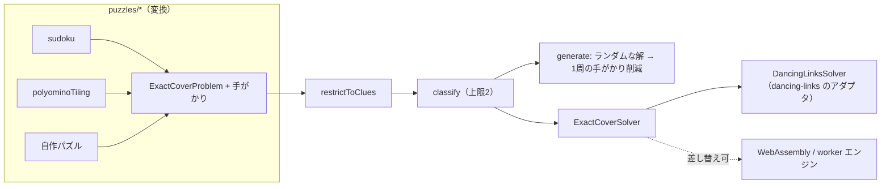

# @rakiastudio/unica

[](https://github.com/RakiaStudio/Unica/actions/workflows/ci.yml)
[](https://www.npmjs.com/package/@rakiastudio/unica)
[](./LICENSE)

exact cover（厳密被覆）の上に作った、唯一解を保証するパズル生成器です。

数独、ポリオミノ詰め、その他「列をちょうど1回ずつ覆うように行を選ぶ」という形に落とせるパズルなら何でも、**唯一解**（解がちょうど1つ）、**極小**（どの手がかりも外せない）、**再現可能**（シードから同じ問題を再生成できる）な問題を生成します。この3語が製品のすべてで、以下はそれぞれを「期待」ではなく「保証」にしている仕組みの説明です。

English: [README.md](./README.md)

## なぜ作ったか

exact cover の「解く」側は JavaScript でも決着が付いています。`dancing-links`、`@algorithm.ts/dlx`、`dlxlib` はいずれも Knuth の Algorithm X の実装で、特に前者は速く、よく保守されています。足りないのはその一段上、**出題する側**です。生成器は数独向けには多くありますが、それ以外のパズル向けにはほとんどなく、しかも「唯一性を検証していない」「パズルごとの後付けの検証で、保証として明文化されていない」ものが目立ちます。

unica はその足りない層です。ソルバーは実装しません（理由は [ADR-0001](./docs/adr/0001-dancing-links.md)）。生成器が正しくやらなければならず、ソルバーには肩代わりできない3つだけを実装しています。

1. **パズルに依存しないモデル。** どんなパズルも `ExactCoverProblem` と「手がかり」（固定する行）の組です。数独もポリオミノもコアの上の数百行の変換で、特別扱いはありません。
2. **早期に打ち切る唯一性判定。** 「唯一解か」は、ソルバーに「解を最大2つ」要求して答えます。この上限があるから、1問の生成中に何十回も唯一性判定を回せます。
3. **構成的に極小になる削減。** 手がかりをランダム順に1周するだけで、どの手がかりも外せない問題になります。その根拠は3行で書けるので、テストに丸投げせず下に書いてあります。

## インストール

```sh
npm install @rakiastudio/unica
```

Node 20 以上、ESM のみ。実行時依存は `dancing-links` の1つだけ（それ自身は依存ゼロ）です。

## 使い方

### 数独

```ts
import { sudoku } from '@rakiastudio/unica';

const s = sudoku(); // 9x9。6x6 なら sudoku({ boxRows: 2, boxCols: 3 })

const puzzle = s.generate({ seed: 'daily-2026-10-29' });
console.log(puzzle.text.puzzle);
//  6...9.74.
//  5..43....
//  8........
//  ..7.5...8
//  .....65..
//  .....1.32
//  3..18..7.
//  ..6..3...
//  ..52.....
console.log(puzzle.clueCount); // 24
console.log(puzzle.minimal); // true: どの手がかりも外せない
console.log(puzzle.seed); // 'daily-2026-10-29'。同じシードで同じ問題になる

s.solve(puzzle.text.puzzle); // 唯一解をテキストで。無い・複数なら undefined
s.classify(text).count; // 'unique' | 'multiple' | 'none'
```

### 数独の難易度

`rate` は人が解くのと同じ手順で数独を解きます。下の手筋を弱いものから順に試し、必要になった最も強い手筋を返します。`explain` は各手順をその理由とともに出力します。

```ts
const s = sudoku();

const puzzle = s.generate({ seed: 'daily-2026-10-29', difficulty: 'medium' });
puzzle.rating.difficulty; // 'medium'
puzzle.rating.hardest; // 'naked pair'
puzzle.attempts; // 12: medium になるまでに生成した問題の数
puzzle.seed; // 'daily-2026-10-29:12'。s.generate({ seed }) でこの問題が直接得られる

s.rate(puzzle.text.puzzle); // { solved, difficulty, hardest, steps }
s.explain(puzzle.text.puzzle);
// [ '1. Naked single: r1c3 can only be 8',
//   '2. Hidden single: 6 can only go in r2c2 within row 2',
//   ...
//   '23. Naked pair: r7c4 and r7c6 hold only 2 and 5 between them, so 2 and 5 leave the other cells of row 7',
//   ...
//   'Solved: medium, hardest technique naked pair.' ]
```

| 難易度   | 意味                                                                                                          |
| -------- | ------------------------------------------------------------------------------------------------------------- |
| `easy`   | naked single と hidden single だけで解ける                                                                    |
| `medium` | naked pair、hidden pair、pointing、claiming のどれかも必要                                                    |
| `hard`   | naked triple、hidden triple、x-wing のどれかも必要                                                            |
| `expert` | naked quad、hidden quad、swordfish、skyscraper、2-string kite、xy-wing、xyz-wing のどれかも必要（0.3.0 から） |
| `beyond` | これらの手筋では詰まる（生成した問題なら唯一解であることは変わらない）                                        |

`rate` は5つのどれも返します。`generate({ difficulty })` が受け付けるのは `easy`、`medium`、`hard`、`expert`（`TARGET_DIFFICULTIES`）で、`beyond` は指定できません。「詰まった」には expert の一歩先から遥かに難しいものまでが含まれ、狙って出す段階にならないためです。唯一解を前提にする手筋（unique rectangle など）と chain 系は意図して入れていません。理由は ADR-0003 にあります。

**0.2 で `beyond` と判定された問題が、0.3.0 からは `expert` と判定されることがあります。** 格付けを保存している場合、0.2 で保存した `beyond` は、今は `expert` を意味しうるということです。保存した `easy`、`medium`、`hard` は変わりません。

難易度は「必要になった最も強い手筋」で決め、手順ごとの点数の合計にはしていません。合計には根拠を示せない重みが要り、解く人に説明もできないからです（[ADR-0003](./docs/adr/0003-difficulty-by-hardest-technique.md)）。手がかりの数と難易度は別物です。テストにある17手がかりの問題は手がかりが最少でありながら `easy` です。

難易度を指定した生成は、与えたシードから派生したシードでやり直します（`k` 回目は `` `${seed}:${k}` ``）。そのため、同じシードからは常に同じ問題が得られます。これは版をまたいでも成り立ちます。新しい手筋は、必ず既存のすべての段階より上に新しい段階として足し、既存の段階に入れたり既存の手筋の間に差し込んだりしない、という決まりがあるからです（ADR-0003）。公開された 0.2.0 が各段階について返した結果をテストに固定し、今の版が同じものを返すことを確かめています。hard は稀（極小な 9x9 の約300問に1問）なので、次の2点に注意してください。

- `generate({ difficulty })` は `maxAttempts`（既定 2000）を使い切ると `ExactCoverError` を投げます。`hard` では約0.1%の見込みです。呼ぶ側で受け止めてください（別のシードでやり直す、など）。
- `hard` の生成は数秒かかることがあります（[性能](#性能)を参照）。画面のあるアプリでは、Web Worker などでメインスレッドの外で回すのを勧めます。

格付けできるのは記号が32種類以下の盤までです。

#### ほかの言語での説明と、その元になるデータ

各手順は、何を根拠にしたかをデータとしても持っています（`step.detail`：パターン、行・列・ブロック、関わったマスと数字）。アプリ側で自由に見せ方を決められます。`explain` はこのデータから文を組み立てます。既定は英語で、日本語も選べます。

```ts
s.explain(puzzle.text.puzzle, { locale: 'ja' });
// [ '1. 残り1つ：1行3列 に入るのは 8 だけ',
//   '2. ここだけ：2行目で 6 が入るのは 2行2列 だけ',
//   ...
//   '解けました：難易度は「ふつう」、最も強い手筋は「候補の組（2つ）」です。' ]
```

日本語の手筋名は、英語をカタカナにせず意味で付けています（例：hidden single は「ここだけ」、skyscraper は「2本の柱」）。マスは「3行5列」、3x3 の区画は「ブロック」と書き、ブロックは左から右、上から下の順に番号を振ります。

それ以外の言語は、自分で `Locale` オブジェクト（`technique`、`difficulty`、`reason`、`summary`、`line`）を渡せば使えます。`src/puzzles/sudoku/locales.ts` の `english` と `japanese` が完全な例です。`step.reason` はこれまでどおり英語の文のままです（[ADR-0004](./docs/adr/0004-explanations-from-step-data.md)）。

格付けは、使ったものの回数も返します。手筋ごとの回数が `rating.uses`、段階ごとの回数が `rating.levels` です。`compareRatings(a, b)` は、重みを使わずに2つの格付けを並べます。比べる順は、難易度、最も強い段階を使った手順の数、`easy` より上の手順の数です。同じ難易度の問題どうしの差を付けるのに使えます。

### ポリオミノ詰め

```ts
import { polyominoTiling, PENTOMINOES } from '@rakiastudio/unica';

const board = polyominoTiling({ width: 10, height: 6, pieces: PENTOMINOES });
const puzzle = board.generate({ seed: 42 });

console.log(puzzle.text.puzzle); // 置かれたピースが2つ、'.' がプレイヤーの作業領域
//  ..........
//  ..........
//  ...UU.....
//  ....U.....
//  .L.UU.....
//  .LLLL.....
console.log(puzzle.text.solution); // 完成させる唯一の方法
//  TTTNNNZVVV
//  ITNNFFZZZV
//  ITXUUFFWZV
//  IXXXUFWWPP
//  ILXUUWWYPP
//  ILLLLYYYYP
```

### 自作のパズル

exact cover として書けるものは、そのまま `generate` に渡せます。

```ts
import { generate, classify, type ExactCoverProblem } from '@rakiastudio/unica';

// Knuth "Dancing Links" (2000) の例題。7列6行、被覆は {B, D, F} の1通り。
const knuth: ExactCoverProblem<string> = {
  primaryColumns: 7,
  secondaryColumns: 0,
  rows: [
    { option: 'A', primary: [0, 3, 6] },
    { option: 'B', primary: [0, 3] },
    { option: 'C', primary: [3, 4, 6] },
    { option: 'D', primary: [2, 4, 5] },
    { option: 'E', primary: [1, 2, 5, 6] },
    { option: 'F', primary: [1, 6] },
  ],
};

classify(knuth, []); // { count: 'unique', solution: [1, 3, 5] }
generate(knuth, { seed: 1 }); // clues: []。手がかり無しで唯一解なので全部外れる
```

「高々1回」の副次列（secondary columns）にも対応しているので、N クイーンの対角線のような任意制約も表現できます。

## 保証と、その根拠

### 唯一解

`classify(problem, clues)` は問題を手がかりで制限し、エンジンに解を最大2つ要求します。0なら `'none'`、1なら `'unique'`、2なら `'multiple'`。ヒューリスティックは介在せず、唯一性は exact cover の探索そのものが決めます。

手がかりの表現はソルバーに手を入れずに済ませています（[ADR-0002](./docs/adr/0002-clues-by-restriction.md)）。手がかりの行を残し、その行と列を共有する他の行をすべて落とす。すると手がかりはその列を覆える唯一の行になるので、制限後の問題のどの解にも必ず含まれます。手がかりとは「競合相手のいない行」のことです。

### 極小

`generate` は完全な解のすべての行を手がかりにした状態から始め、手がかりをランダム順に訪問し、外しても唯一解のままなら外します。

1周で足りるのは、唯一性が**手がかり集合について単調**だからです。手がかりを減らすと解は増えることはあっても減ることはない。手がかりが多かった時点で外せなかった手がかりは、手がかりが減った今も外せない。したがって全部を1回ずつ訪問した後、残っている手がかりはすべて必要です。

テスト（`isMinimal` が全手がかりを再検証）とプロパティテスト（ランダムなシード）でも確認していますが、正しさの根拠は上の議論であって、テストではありません。

### 再現可能

`generate` はシード付き疑似乱数（sfc32）で駆動され、使ったシードを結果に含めます。同じ問題と同じシードなら常に同じパズルになります。バグ報告はシード1つで済みます。数独を難易度指定で生成した場合は、どの試行を採るかを格付けが決めるので、版の間で格付けが変わらないことにも依っています。それを保証するのが ADR-0003 の手筋の足し方の決まりで、公開された 0.2.0 と比べる fixture のテストがそれを確かめています。

## 構成



| モジュール            | 責務                                                                      |
| --------------------- | ------------------------------------------------------------------------- |
| `core/exact-cover.ts` | データモデル、検証、`restrictToClues`（手がかりを「強制された行」にする） |
| `core/solver.ts`      | `ExactCoverSolver` インターフェースと `dancing-links` アダプタ            |
| `core/classify.ts`    | `classify`、`isUnique`、`isMinimal`、`solveUnique`                        |
| `core/generate.ts`    | `randomSolution` と `generate`（手がかり削減）                            |
| `core/random.ts`      | シード付き乱数と順列                                                      |
| `puzzles/sudoku`      | 任意のボックス形の数独 → exact cover、テキスト記法、`generate`/`solve`    |
| `puzzles/polyomino`   | 穴と対称性オプション付きのポリオミノ詰め → exact cover、12種のペントミノ  |

自明でなかった設計判断は [`docs/adr`](./docs/adr) に ADR として残しています。

## API

コアのAPIは意図的に小さくしてあります。

| 関数                                     | 返り値                                                                     |
| ---------------------------------------- | -------------------------------------------------------------------------- |
| `classify(problem, clues, solver?)`      | `{ count: 'none' \| 'unique' \| 'multiple', solution }`                    |
| `isUnique(problem, clues, solver?)`      | `boolean`                                                                  |
| `isMinimal(problem, clues, solver?)`     | `boolean`（唯一解で、かつ冗長な手がかりが無い）                            |
| `solveUnique(problem, clues, solver?)`   | 解。無い・複数なら `undefined`                                             |
| `generate(problem, options?)`            | `{ seed, clues, solution, removed, minimal }`                              |
| `randomSolution(problem, rng, solver?)`  | 行順をシャッフルして得た解を1つ                                            |
| `restrictToClues(problem, clues)`        | 制限した問題と行の対応表                                                   |
| `createRng(seed)`、`permutation(n, rng)` | 決定的な乱数                                                               |
| `sudoku(options?)`                       | 変換、`parse`/`format`、`generate`、`solve`、`classify`、`rate`、`explain` |
| `polyominoTiling(options)`               | 変換、`orientations`、`format`、`generate`                                 |

`GenerateOptions`：`seed`、`solver`、`solution`（既知の解から始める。exact cover になっていない解は `ExactCoverError`）、`stopAtClues`（削減を途中で止める。結果は唯一解だが極小とは限らず、`minimal` がそれを示す）。

型はすべて export しています。`tsconfig` は `strict` に加えて `noUncheckedIndexedAccess` と `exactOptionalPropertyTypes` を有効にしており、コードベースに `any` はありません。

## テスト

エンジンに自分の答案の採点はさせません。生成した数独について「唯一解である」とテストが主張するときは、`src/` とコードを一切共有しない `test/helpers/brute-force.ts` の独立したバックトラック探索が検証します。生成したペントミノ問題は、テストではエンジンの `isUnique` で、公開後の確認（`scripts/verify-published.mjs`）では別の oracle で確かめています。

- **答えの分かっている fixture**：Knuth の例題（被覆は `{B, D, F}` の1通り）、17手がかりの数独（17 は唯一解に必要な手がかり数の証明済み最小値、McGuire・Tugemann・Civario、2012）、63種の固定ペントミノ、3x20 の長方形の8通りの敷き詰め（対称を除いて2通り、×4）。
- **プロパティテスト**（`fast-check`）：ランダムなシードに対して、生成した数独（4x4、9x9）がすべて oracle で唯一解、3x20 のペントミノ問題がすべて `isUnique` で唯一解で、どちらも `isMinimal` で極小であること、`generate` の出力が削減の不動点であること、独立な二択の積では各選択につきちょうど1つの手がかりが残ること、`permutation` が常に全単射であること。
- **数独の手筋の健全性**（`fast-check`）：生成した 4x4、6x6、9x9 の問題（`medium`、`hard`、`expert` を指定して生成したものを含む）について、格付けが通るすべての局面ですべての手筋に手順を求め、その配置と候補の削除をすべて oracle の解と照合します。解き切った格付けは、その解で終わらなければなりません。各手筋には手作りの候補盤による単体テストもあります。
- **版をまたいだ再現性**：公開された 0.2.0 が `generate({ seed, difficulty })` に対して返した問題、試行回数、格付け、`explain` の出力を fixture にし、今の版が同じものを返すことを確かめます。
- **カバレッジ**：文 99%（0.3.0 時点。95% 以上を保つ方針）。未到達行は型で排除できない状態に対する防御分岐です。
- **公開されたパッケージ**：リリースのたびに、ワークフローが新しい版を npm から空のディレクトリへ利用者と同じ手順で入れ、`npm audit signatures` でレジストリの署名と provenance を確かめてから `scripts/verify-published.mjs` を実行します。このスクリプトは `src/` ともテストともコードを共有しません。自前のバックトラック探索をまず既知の数（4x4 数独の完成盤 288 通り、3x20 の長方形の敷き詰め 8 通り）で確かめ、そのうえで生成した問題が唯一解・極小・再現可能であること、README の例が書いてあるとおりに出力されることを確かめます。成否と実行へのリンクは GitHub のリリースに追記されます。これは公開物が保証を守っていることの確認であって、安全性の審査ではありません。

```sh
npm test            # vitest
npm run bench       # vitest bench
npm run check       # lint + typecheck + test + build。CI と同じ
```

## 性能

`npm run bench`（Node 22、1コア）の計測値。「生成」はランダムな解の取得と極小化の1周を含みます。`hard` と `expert` の行は同じ環境でそれぞれシード100個について測りました（試行回数は `hard` が中央値101回・最悪1147回、`expert` が中央値6回・最悪74回）。いずれも測定した条件での値で、速さを保証するものではありません。

| 処理                                 | 時間                           |
| ------------------------------------ | ------------------------------ |
| 空の 9x9 数独の classify（上限2）    | 約 0.13 ms                     |
| 極小な 9x9 数独の生成                | 約 6.5 ms                      |
| 極小な 16x16 数独の生成              | 約 1.4 s                       |
| 6x10 ペントミノ敷き詰めを1つ見つける | 約 3 ms                        |
| 極小な 6x10 ペントミノ問題の生成     | 約 12 ms                       |
| `hard` 指定の 9x9 数独の生成         | 中央値 約 0.3 s、最悪 数 s     |
| `expert` 指定の 9x9 数独の生成       | 中央値 約 20 ms、最悪 約 0.2 s |

生成コストは「手がかり数 × 上限付き探索1回のコスト」でほぼ決まります。その探索を安くするのはエンジンの仕事で、だからエンジンは自作ではなく依存にしています。

## ロードマップ

- **遊べるデモ**（GitHub Pages、ブラウザ内で生成）。
- **変換の追加**：N クイーン、カックロなど exact cover にきれいに落ちるもの。
- **代替エンジン**（WebAssembly、worker）を `ExactCoverSolver` の裏に、必要になったら。

## 貢献

[CONTRIBUTING.md](./CONTRIBUTING.md) を参照。コミットは Conventional Commits、リリースは Changesets で管理し、npm provenance 付きで公開します。

## ライセンス

MIT. Copyright (c) 2026 RakiaStudio.
