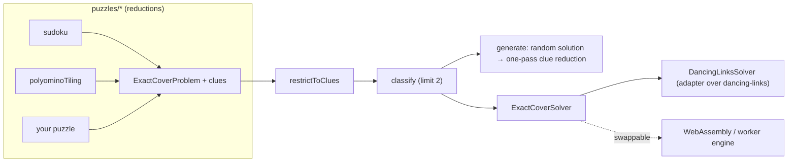

# @rakiastudio/unica

[](https://github.com/RakiaStudio/Unica/actions/workflows/ci.yml)
[](https://www.npmjs.com/package/@rakiastudio/unica)
[](./LICENSE)
[](./package.json)

Unique-solution puzzle generator built on exact cover.

Give unica any puzzle that reduces to exact cover (sudoku, polyomino tiling, and
anything else you can express as "choose rows so that every column is covered
exactly once") and it generates instances that are **unique** (exactly one
solution), **minimal** (every clue is necessary) and **reproducible** (a seed
recreates the puzzle). Those three words are the whole product; the rest of this
document explains how each one is guaranteed rather than hoped for.

日本語版は [README.ja.md](./README.ja.md) にあります。

## Why this exists

Exact cover solvers are a solved problem in JavaScript: `dancing-links`,
`@algorithm.ts/dlx` and `dlxlib` all implement Knuth's Algorithm X, and the
first of them is fast and well maintained. What the ecosystem lacks is the layer
above the solver. Puzzle _generators_ are plentiful for sudoku and scarce for
everything else, and a surprising number of them either do not check uniqueness
at all or check it only after the fact, per puzzle type, with no stated
guarantee.

unica is that missing layer. It does not implement a solver (see
[ADR-0001](./docs/adr/0001-dancing-links.md) for why). It implements the three
things a generator must get right and that a solver cannot do for you:

1. **A puzzle-agnostic model.** Any puzzle is an `ExactCoverProblem` plus a set
   of _clues_ (fixed rows). Sudoku and polyomino tiling are a couple of hundred lines each
   on top of the core; they are examples, not special cases.
2. **A uniqueness oracle that stops early.** "Is this unique?" is answered by
   asking the solver for at most two solutions. That bound is what makes
   checking uniqueness dozens of times per puzzle affordable.
3. **A reduction that is minimal by construction.** One pass over the clues in
   random order yields a puzzle where no clue can be removed. The argument is
   three lines long and is written down below, not left to testing.

## Install

```sh
npm install @rakiastudio/unica
```

Node 20 or later, ESM only. One runtime dependency (`dancing-links`, itself
dependency-free).

## Quick start

### Sudoku

```ts
import { sudoku } from '@rakiastudio/unica';

const s = sudoku(); // 9x9; sudoku({ boxRows: 2, boxCols: 3 }) for 6x6, etc.

const puzzle = s.generate({ seed: 'daily-2026-10-29' });
console.log(puzzle.text.puzzle);
//  6...9.74.
//  5..43....
//  8........
//  ..7.5...8
//  .....65..
//  .....1.32
//  3..18..7.
//  ..6..3...
//  ..52.....
console.log(puzzle.clueCount); // 24
console.log(puzzle.minimal); // true: no clue can be removed
console.log(puzzle.seed); // 'daily-2026-10-29' — regenerates the same puzzle

s.solve(puzzle.text.puzzle); // the unique solution as text, or undefined
s.classify('..3.2.6..9..3.5..1..18.64....81.29..7.......8..67.82....26.95..8..2.3..9..5.1.3..')
  .count;
// 'unique' | 'multiple' | 'none'
```

### Polyomino tiling

```ts
import { polyominoTiling, PENTOMINOES } from '@rakiastudio/unica';

const board = polyominoTiling({ width: 10, height: 6, pieces: PENTOMINOES });
const puzzle = board.generate({ seed: 42 });

console.log(puzzle.text.puzzle); // two pieces placed; '.' is where the player works
//  ..........
//  ..........
//  ...UU.....
//  ....U.....
//  .L.UU.....
//  .LLLL.....
console.log(puzzle.text.solution); // the only way to finish it
//  TTTNNNZVVV
//  ITNNFFZZZV
//  ITXUUFFWZV
//  IXXXUFWWPP
//  ILXUUWWYPP
//  ILLLLYYYYP
```

### Your own puzzle

Anything you can phrase as exact cover works unchanged with `generate`:

```ts
import { generate, classify, type ExactCoverProblem } from '@rakiastudio/unica';

// Knuth's example from "Dancing Links" (2000): 7 columns, 6 rows, one cover {B, D, F}.
const knuth: ExactCoverProblem<string> = {
  primaryColumns: 7,
  secondaryColumns: 0,
  rows: [
    { option: 'A', primary: [0, 3, 6] },
    { option: 'B', primary: [0, 3] },
    { option: 'C', primary: [3, 4, 6] },
    { option: 'D', primary: [2, 4, 5] },
    { option: 'E', primary: [1, 2, 5, 6] },
    { option: 'F', primary: [1, 6] },
  ],
};

classify(knuth, []); // { count: 'unique', solution: [1, 3, 5] }
generate(knuth, { seed: 1 }); // clues: [] — the problem needs no clues to be unique
```

Secondary columns ("at most once") are supported, which is what you need for
puzzles with optional constraints such as N-queens diagonals.

## Guarantees, and why they hold

### Unique

`classify(problem, clues)` restricts the problem to the clues and asks the engine
for at most two solutions. Zero means `'none'`, one means `'unique'`, two means
`'multiple'`. There is no heuristic involved: uniqueness is decided by the exact
cover search itself.

Clues are encoded without touching the solver
([ADR-0002](./docs/adr/0002-clues-by-restriction.md)). A clue row is kept and
every other row that shares a column with it is dropped. The clue is then the only
row able to cover its columns, so every solution of the restricted problem
contains it. A clue is simply a row with no competitors.

### Minimal

`generate` starts from a complete solution with every row fixed as a clue, visits
the clues in random order, and removes each one if the puzzle stays unique.

One pass suffices because uniqueness is **monotone in the clue set**: removing
clues can only add solutions, never remove them. A clue that could not be removed
when the clue set was larger can still not be removed now that it is smaller.
Therefore, after visiting every clue once, every remaining clue is necessary.

This is asserted by tests (`isMinimal` re-checks every clue) and by property
tests over random seeds, but it is true by the argument above, not by the tests.

### Reproducible

Every call to `generate` is driven by a seeded PRNG (sfc32) and reports the seed
it used. The same problem and seed always produce the same puzzle. A bug report
is a seed.

## Architecture



| Module                | Responsibility                                                                         |
| --------------------- | -------------------------------------------------------------------------------------- |
| `core/exact-cover.ts` | The data model, validation, and `restrictToClues` (how clues become forced rows)       |
| `core/solver.ts`      | The `ExactCoverSolver` interface and the `dancing-links` adapter                       |
| `core/classify.ts`    | `classify`, `isUnique`, `isMinimal`, `solveUnique`                                     |
| `core/generate.ts`    | `randomSolution` and `generate` (clue reduction)                                       |
| `core/random.ts`      | Seeded PRNG and permutations                                                           |
| `puzzles/sudoku`      | Sudoku of any box shape → exact cover; text notation; convenience `generate`/`solve`   |
| `puzzles/polyomino`   | Polyomino tiling with holes and symmetry options → exact cover; the twelve pentominoes |

Design decisions that were not obvious are recorded as ADRs in
[`docs/adr`](./docs/adr).

## API

The core API is small on purpose.

| Function                                 | Returns                                                      |
| ---------------------------------------- | ------------------------------------------------------------ |
| `classify(problem, clues, solver?)`      | `{ count: 'none' \| 'unique' \| 'multiple', solution }`      |
| `isUnique(problem, clues, solver?)`      | `boolean`                                                    |
| `isMinimal(problem, clues, solver?)`     | `boolean` (unique, and no clue is redundant)                 |
| `solveUnique(problem, clues, solver?)`   | the solution, or `undefined`                                 |
| `generate(problem, options?)`            | `{ seed, clues, solution, removed, minimal }`                |
| `randomSolution(problem, rng, solver?)`  | one solution, randomised through the row order               |
| `restrictToClues(problem, clues)`        | the restricted problem and a row map                         |
| `createRng(seed)`, `permutation(n, rng)` | deterministic randomness                                     |
| `sudoku(options?)`                       | reduction, `parse`/`format`, `generate`, `solve`, `classify` |
| `polyominoTiling(options)`               | reduction, `orientations`, `format`, `generate`              |

`GenerateOptions`: `seed`, `solver`, `solution` (start from a known solution; one
that is not an exact cover is rejected with `ExactCoverError`),
`stopAtClues` (stop reducing early; the result is then unique but not guaranteed
minimal, and `minimal` says so).

All types are exported. `tsconfig` is `strict` with `noUncheckedIndexedAccess` and
`exactOptionalPropertyTypes`; the codebase contains no `any`.

## Testing

The engine is not allowed to grade its own homework. Every uniqueness claim made
by a test about a _generated_ puzzle is verified by an independent backtracking
solver in `test/helpers/brute-force.ts` that shares no code with `src/`.

- **Fixtures with known answers**: Knuth's worked example (one cover, `{B, D, F}`),
  a 17-clue sudoku (17 being the proven minimum, McGuire, Tugemann and Civario,
  2012), the 63 fixed pentominoes, and the 8 tilings of the 3x20 rectangle
  (2 up to symmetry, times 4).
- **Property tests** (`fast-check`): over random seeds, every generated sudoku
  (4x4 and 9x9) and every generated 3x20 pentomino puzzle is unique by the oracle
  and minimal by `isMinimal`; `generate` is a fixed point under reduction; on a
  product of independent binary choices the generator keeps exactly one clue per
  choice; `permutation` is always a bijection.
- **Coverage**: 98% statements. The uncovered lines are defensive
  branches for states the type system cannot rule out.
- **The published package**: after every release, a workflow installs the new
  version from npm into an empty directory, as a user would, checks its registry
  signatures and provenance, and runs `scripts/verify-published.mjs`. That script
  shares no code with `src/` or with the test-suite. Its own backtracking solvers
  are first calibrated on known counts (288 complete 4x4 sudokus, 8 tilings of
  the 3x20 rectangle), then confirm that generated puzzles are unique, minimal
  and reproducible, and that the README examples print what this document says.
  The result is added to the GitHub release.

```sh
npm test            # vitest
npm run bench       # vitest bench
npm run check       # lint + typecheck + test + build, same as CI
```

## Performance

Measured with `npm run bench` on a single core (Node 22). "Generate" includes
finding a random solution and the full minimality pass.

| Task                                     | Time     |
| ---------------------------------------- | -------- |
| Classify an empty 9x9 sudoku (limit 2)   | ~0.13 ms |
| Generate a minimal 9x9 sudoku            | ~6.5 ms  |
| Generate a minimal 16x16 sudoku          | ~1.4 s   |
| Find one 6x10 pentomino tiling           | ~3 ms    |
| Generate a minimal 6x10 pentomino puzzle | ~12 ms   |

Generation cost is dominated by the number of clues times the cost of one
bounded solve. Keeping that solve cheap is the engine's job, which is why the
engine is a dependency and not a rewrite.

## Roadmap

- **v0.2 — difficulty with reasons.** A human-technique solver for sudoku
  (singles, hidden singles, pairs, …) that rates a puzzle by the strongest
  technique it needs and returns the log of techniques used. The generator will
  accept a target difficulty.
- **Playable demo** on GitHub Pages, generating in the browser.
- **More reductions**: N-queens, kakuro, and other puzzles with a clean exact
  cover formulation.
- **Alternative engines** behind `ExactCoverSolver` (WebAssembly, workers) once a
  workload needs them.

## Contributing

See [CONTRIBUTING.md](./CONTRIBUTING.md). Commits follow Conventional Commits;
releases are managed with Changesets and published with npm provenance.

## License

MIT. Copyright (c) 2026 RakiaStudio.
