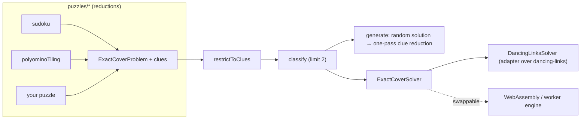

# @rakiastudio/unica

[](https://github.com/RakiaStudio/Unica/actions/workflows/ci.yml)
[](https://www.npmjs.com/package/@rakiastudio/unica)
[](./LICENSE)
[](./package.json)

Unique-solution puzzle generator built on exact cover.

Give unica any puzzle that reduces to exact cover (sudoku, polyomino tiling, and
anything else you can express as "choose rows so that every column is covered
exactly once") and it generates instances that are **unique** (exactly one
solution), **minimal** (every clue is necessary) and **reproducible** (a seed
recreates the puzzle). Those three words are the whole product; the rest of this
document explains how each one is guaranteed rather than hoped for.

日本語版は [README.ja.md](./README.ja.md) にあります。

## Why this exists

Exact cover solvers are a solved problem in JavaScript: `dancing-links`,
`@algorithm.ts/dlx` and `dlxlib` all implement Knuth's Algorithm X, and the
first of them is fast and well maintained. What the ecosystem lacks is the layer
above the solver. Puzzle generators are plentiful for sudoku, and some of them
do produce puzzles with a unique solution. But every one found while building
unica was specific to sudoku. None stated uniqueness and minimality as
guarantees over a shared exact cover form that other puzzles could use as well.

unica is that missing layer. It does not implement a solver (see
[ADR-0001](./docs/adr/0001-dancing-links.md) for why). It implements the three
things a generator must get right and that a solver cannot do for you:

1. **A puzzle-agnostic model.** Any puzzle is an `ExactCoverProblem` plus a set
   of _clues_ (fixed rows). Sudoku and polyomino tiling are a couple of hundred lines each
   on top of the core; they are examples, not special cases.
2. **A uniqueness oracle that stops early.** "Is this unique?" is answered by
   asking the solver for at most two solutions. That bound is what makes
   checking uniqueness dozens of times per puzzle affordable.
3. **A reduction that is minimal by construction.** One pass over the clues in
   random order yields a puzzle where no clue can be removed. The argument is
   three lines long and is written down below, not left to testing.

## Install

```sh
npm install @rakiastudio/unica
```

Node 20 or later, ESM only. One runtime dependency (`dancing-links`, itself
dependency-free).

## Quick start

### Sudoku

```ts
import { sudoku } from '@rakiastudio/unica';

const s = sudoku(); // 9x9; sudoku({ boxRows: 2, boxCols: 3 }) for 6x6, etc.

const puzzle = s.generate({ seed: 'daily-2026-10-29' });
console.log(puzzle.text.puzzle);
//  6...9.74.
//  5..43....
//  8........
//  ..7.5...8
//  .....65..
//  .....1.32
//  3..18..7.
//  ..6..3...
//  ..52.....
console.log(puzzle.clueCount); // 24
console.log(puzzle.minimal); // true: no clue can be removed
console.log(puzzle.seed); // 'daily-2026-10-29' — regenerates the same puzzle

s.solve(puzzle.text.puzzle); // the unique solution as text, or undefined
s.classify('..3.2.6..9..3.5..1..18.64....81.29..7.......8..67.82....26.95..8..2.3..9..5.1.3..')
  .count;
// 'unique' | 'multiple' | 'none'
```

### Sudoku difficulty

`rate` solves a sudoku the way a person would, with the techniques below tried
weakest first, and reports the strongest one it needed. `explain` prints every
step with its reason.

```ts
const s = sudoku();

const puzzle = s.generate({ seed: 'daily-2026-10-29', difficulty: 'medium' });
puzzle.rating.difficulty; // 'medium'
puzzle.rating.hardest; // 'naked pair'
puzzle.attempts; // 12: puzzles generated until one rated medium
puzzle.seed; // 'daily-2026-10-29:12' — s.generate({ seed }) gives this puzzle directly

s.rate(puzzle.text.puzzle); // { solved, difficulty, hardest, steps }
s.explain(puzzle.text.puzzle);
// [ '1. Naked single: r1c3 can only be 8',
//   '2. Hidden single: 6 can only go in r2c2 within row 2',
//   ...
//   '23. Naked pair: r7c4 and r7c6 hold only 2 and 5 between them, so 2 and 5 leave the other cells of row 7',
//   ...
//   'Solved: medium, hardest technique naked pair.' ]
```

| Difficulty | Meaning                                                                                                       |
| ---------- | ------------------------------------------------------------------------------------------------------------- |
| `easy`     | naked and hidden singles are enough                                                                           |
| `medium`   | also needs a naked pair, hidden pair, pointing or claiming                                                    |
| `hard`     | also needs a naked triple, hidden triple or x-wing                                                            |
| `expert`   | also needs a naked quad, hidden quad, swordfish, skyscraper, 2-string kite, xy-wing or xyz-wing (since 0.3.0) |
| `master`   | also needs a jellyfish, finned x-wing, finned swordfish, empty rectangle, w-wing or wxyz-wing (since 0.6.0)   |
| `beyond`   | these techniques get stuck (a generated puzzle is still unique)                                               |

`rate` can return all six. `generate({ difficulty })` accepts `easy`, `medium`,
`hard`, `expert` and `master` (`TARGET_DIFFICULTIES`) but not `beyond`: being
stuck covers puzzles from one step past master to far harder, so it is not a level to aim
for. Uniqueness techniques (such as unique rectangles) and chains are left out
on purpose; ADR-0003 says why.

**A puzzle that 0.2 rated `beyond` can be rated `expert` from 0.3.0 on, and one
that 0.5 rated `beyond` can be rated `master` from 0.6.0 on.** If you store
ratings, a stored `beyond` may now mean a newer level. Stored ratings of every
other level do not change.

The difficulty is the strongest technique needed, not a sum of step scores:
a sum needs weights nobody can justify, and cannot be explained to a solver
([ADR-0003](./docs/adr/0003-difficulty-by-hardest-technique.md)). Clue count and
difficulty are separate things: the 17-clue puzzle in the test suite has the
fewest clues possible and rates `easy`.

Generating to a difficulty retries with seeds derived from yours (attempt `k`
uses `` `${seed}:${k}` ``), so the same seed always gives the same puzzle.
That also holds across versions, because of one rule: new techniques are only
ever added as a new level above all the others, never into an existing level
and never between existing techniques (ADR-0003). A test pins what the
published 0.2.0 returned for each level and checks that this version returns
the same.
Hard puzzles are rare (about 1 in 300 minimal 9x9 puzzles), so:

- `generate({ difficulty })` throws `ExactCoverError` when `maxAttempts`
  (default 2000) runs out. For `hard` this is expected to happen about 0.1% of the time;
  callers should catch it, for example by retrying with another seed.
- `hard` generation can take seconds (see [Performance](#performance)). In an
  app with a UI, run it off the main thread, for example in a Web Worker.

Rating supports grids of up to 32 symbols.

#### Explanations in other languages, and the data behind them

Every step also carries what it was based on as data, `step.detail` (the
pattern, the row, column or box, the cells and the values), so an app can
present it however it likes. `explain` builds its sentences from that data in
English by default, or in Japanese:

```ts
s.explain(puzzle.text.puzzle, { locale: 'ja' });
// [ '1. Naked single：1行3列 に入るのは 8 だけ',
//   '2. Hidden single：2行目で 6 が入るのは 2行2列 だけ',
//   ...
//   '解けました：難易度は「ふつう」、最も強い手筋は「Naked pair」です。' ]
```

For any other language, pass your own `Locale` object (`technique`,
`difficulty`, `reason`, `summary`, `line`); see `english` and `japanese` in
`src/puzzles/sudoku/locales.ts` for complete examples. `step.reason` stays the
English sentence ([ADR-0004](./docs/adr/0004-explanations-from-step-data.md)).

A rating also counts what it used: `rating.uses` per technique and
`rating.levels` per level. `compareRatings(a, b)` orders two ratings without
weights: by difficulty, then by how many steps needed the hardest level, then by
how many steps needed anything above `easy`. Use it to tell apart puzzles of the
same difficulty.

### Polyomino tiling

```ts
import { polyominoTiling, PENTOMINOES } from '@rakiastudio/unica';

const board = polyominoTiling({ width: 10, height: 6, pieces: PENTOMINOES });
const puzzle = board.generate({ seed: 42 });

console.log(puzzle.text.puzzle); // two pieces placed; '.' is where the player works
//  ..........
//  ..........
//  ...UU.....
//  ....U.....
//  .L.UU.....
//  .LLLL.....
console.log(puzzle.text.solution); // the only way to finish it
//  TTTNNNZVVV
//  ITNNFFZZZV
//  ITXUUFFWZV
//  IXXXUFWWPP
//  ILXUUWWYPP
//  ILLLLYYYYP
```

### Your own puzzle

Anything you can phrase as exact cover works unchanged with `generate`:

```ts
import { generate, classify, type ExactCoverProblem } from '@rakiastudio/unica';

// Knuth's example from "Dancing Links" (2000): 7 columns, 6 rows, one cover {B, D, F}.
const knuth: ExactCoverProblem<string> = {
  primaryColumns: 7,
  secondaryColumns: 0,
  rows: [
    { option: 'A', primary: [0, 3, 6] },
    { option: 'B', primary: [0, 3] },
    { option: 'C', primary: [3, 4, 6] },
    { option: 'D', primary: [2, 4, 5] },
    { option: 'E', primary: [1, 2, 5, 6] },
    { option: 'F', primary: [1, 6] },
  ],
};

classify(knuth, []); // { count: 'unique', solution: [1, 3, 5] }
generate(knuth, { seed: 1 }); // clues: [] — the problem needs no clues to be unique
```

Secondary columns ("at most once") are supported, which is what you need for
puzzles with optional constraints such as N-queens diagonals.

## Guarantees, and why they hold

### Unique

`classify(problem, clues)` restricts the problem to the clues and asks the engine
for at most two solutions. Zero means `'none'`, one means `'unique'`, two means
`'multiple'`. There is no heuristic involved: uniqueness is decided by the exact
cover search itself.

Clues are encoded without touching the solver
([ADR-0002](./docs/adr/0002-clues-by-restriction.md)). A clue row is kept and
every other row that shares a column with it is dropped. The clue is then the only
row able to cover its columns, so every solution of the restricted problem
contains it. A clue is simply a row with no competitors.

### Minimal

`generate` starts from a complete solution with every row fixed as a clue, visits
the clues in random order, and removes each one if the puzzle stays unique.

One pass suffices because uniqueness is **monotone in the clue set**: removing
clues can only add solutions, never remove them. A clue that could not be removed
when the clue set was larger can still not be removed now that it is smaller.
Therefore, after visiting every clue once, every remaining clue is necessary.

This is asserted by tests (`isMinimal` re-checks every clue) and by property
tests over random seeds, but it is true by the argument above, not by the tests.

### Reproducible

Every call to `generate` is driven by a seeded PRNG (sfc32) and reports the seed
it used. The same problem and seed always produce the same puzzle. A bug report
is a seed. For sudoku generated to a difficulty, the rating decides which attempt
is kept, so this also relies on ratings not changing between versions; the rule
for adding techniques in ADR-0003 is what guarantees that, and a fixture test
against the published 0.2.0 checks it.

## Architecture



| Module                | Responsibility                                                                         |
| --------------------- | -------------------------------------------------------------------------------------- |
| `core/exact-cover.ts` | The data model, validation, and `restrictToClues` (how clues become forced rows)       |
| `core/solver.ts`      | The `ExactCoverSolver` interface and the `dancing-links` adapter                       |
| `core/classify.ts`    | `classify`, `isUnique`, `isMinimal`, `solveUnique`                                     |
| `core/generate.ts`    | `randomSolution` and `generate` (clue reduction)                                       |
| `core/random.ts`      | Seeded PRNG and permutations                                                           |
| `puzzles/sudoku`      | Sudoku of any box shape → exact cover; text notation; convenience `generate`/`solve`   |
| `puzzles/polyomino`   | Polyomino tiling with holes and symmetry options → exact cover; the twelve pentominoes |

Design decisions that were not obvious are recorded as ADRs in
[`docs/adr`](./docs/adr).

## API

The core API is small on purpose.

| Function                                 | Returns                                                                         |
| ---------------------------------------- | ------------------------------------------------------------------------------- |
| `classify(problem, clues, solver?)`      | `{ count: 'none' \| 'unique' \| 'multiple', solution }`                         |
| `isUnique(problem, clues, solver?)`      | `boolean`                                                                       |
| `isMinimal(problem, clues, solver?)`     | `boolean` (unique, and no clue is redundant)                                    |
| `solveUnique(problem, clues, solver?)`   | the solution, or `undefined`                                                    |
| `generate(problem, options?)`            | `{ seed, clues, solution, removed, minimal }`                                   |
| `randomSolution(problem, rng, solver?)`  | one solution, randomised through the row order                                  |
| `restrictToClues(problem, clues)`        | the restricted problem and a row map                                            |
| `createRng(seed)`, `permutation(n, rng)` | deterministic randomness                                                        |
| `sudoku(options?)`                       | reduction, `parse`/`format`, `generate`, `solve`, `classify`, `rate`, `explain` |
| `polyominoTiling(options)`               | reduction, `orientations`, `format`, `generate`                                 |

`GenerateOptions`: `seed`, `solver`, `solution` (start from a known solution; one
that is not an exact cover is rejected with `ExactCoverError`),
`stopAtClues` (stop reducing early; the result is then unique but not guaranteed
minimal, and `minimal` says so).

All types are exported. `tsconfig` is `strict` with `noUncheckedIndexedAccess` and
`exactOptionalPropertyTypes`; the codebase contains no `any`.

## Testing

The engine is not allowed to grade its own homework. Every uniqueness claim made
by a test about a _generated_ puzzle (sudoku or pentomino) is verified by an
independent backtracking solver in `test/helpers/brute-force.ts` that shares no
code with `src/`. The pentomino oracle draws its own twelve shapes and is first
checked on the 63 fixed pentominoes and the 8 tilings of the 3x20 rectangle.

- **Fixtures with known answers**: Knuth's worked example (one cover, `{B, D, F}`),
  a 17-clue sudoku (17 being the proven minimum, McGuire, Tugemann and Civario,
  2012), the 63 fixed pentominoes, and the 8 tilings of the 3x20 rectangle
  (2 up to symmetry, times 4).
- **Property tests** (`fast-check`): over random seeds, every generated sudoku
  (4x4 and 9x9) and every generated 3x20 pentomino puzzle is unique by the oracle
  and minimal by `isMinimal`; `generate` is a fixed point under reduction; on a
  product of independent binary choices the generator keeps exactly one clue per
  choice; `permutation` is always a bijection.
- **Soundness of the sudoku techniques** (`fast-check`): over generated 4x4, 6x6
  and 9x9 puzzles (including ones generated to `medium`, `hard`, `expert` and
  `master`), every
  technique is asked for a step at every state the rater passes through, and
  every placement and elimination is checked against the oracle's solution. A
  solved rating must end on that solution. Each technique also has unit tests on
  handcrafted candidate states.
- **Across versions**: the puzzles, attempts, ratings and `explain` output that
  the published 0.2.0 returned for `generate({ seed, difficulty })` are
  fixtures, and this version must return the same.
- **Coverage**: 99.23% statements, 97.6% branches and 100% functions as of
  0.5.0 (the project keeps statements at 95% or more). The uncovered lines are
  defensive
  branches for states the type system cannot rule out.
- **The published package**: after every release, a workflow installs the new
  version from npm into an empty directory, as a user would, checks its registry
  signatures and provenance with `npm audit signatures`, and runs
  `scripts/verify-published.mjs`. That script
  shares no code with `src/` or with the test-suite. Its own backtracking solvers
  are first calibrated on known counts (288 complete 4x4 sudokus, 8 tilings of
  the 3x20 rectangle), then confirm that generated puzzles are unique, minimal
  and reproducible, and that the README examples print what this document says.
  The outcome and a link to the run are added to the GitHub release. These checks
  show that the published package keeps its guarantees; they are not a security
  review.

```sh
npm test            # vitest
npm run bench       # vitest bench
npm run check       # lint + typecheck + test + build, same as CI
```

## Performance

Measured with `npm run bench` on a single core (Node 22). "Generate" includes
finding a random solution and the full minimality pass. The `hard`, `expert`
and `master` rows were measured over 100 seeds each on the same setup (`hard`:
median 101 attempts, worst 1147; `expert`: median 6, worst 74; `master`: median
11, worst 46).
These are the values measured on that setup, not promises.

| Task                                     | Time                         |
| ---------------------------------------- | ---------------------------- |
| Classify an empty 9x9 sudoku (limit 2)   | ~0.13 ms                     |
| Generate a minimal 9x9 sudoku            | ~6.5 ms                      |
| Generate a minimal 16x16 sudoku          | ~1.4 s                       |
| Find one 6x10 pentomino tiling           | ~3 ms                        |
| Generate a minimal 6x10 pentomino puzzle | ~12 ms                       |
| Generate a 9x9 sudoku rated `hard`       | median ~0.3 s, worst a few s |
| Generate a 9x9 sudoku rated `expert`     | median ~20 ms, worst ~0.2 s  |
| Generate a 9x9 sudoku rated `master`     | median ~45 ms, worst ~0.25 s |

Generation cost is dominated by the number of clues times the cost of one
bounded solve. Keeping that solve cheap is the engine's job, which is why the
engine is a dependency and not a rewrite.

## Roadmap

- **Playable demo** on GitHub Pages, generating in the browser.
- **More reductions**: N-queens and other puzzles with a clean exact cover
  formulation, and ones like kakuro that need extra work to keep crossing sums
  consistent.
- **Alternative engines** behind `ExactCoverSolver` (WebAssembly, workers) once a
  workload needs them.

## Contributing

See [CONTRIBUTING.md](./CONTRIBUTING.md). Commits follow Conventional Commits;
releases are managed with Changesets and published with npm provenance.

## License

MIT. Copyright (c) 2026 RakiaStudio.

## Trademarks

"Sudoku" (数独) and "Kakuro" (カックロ) are registered trademarks of Nikoli Co.,
Ltd. in Japan. unica is not affiliated with Nikoli.
